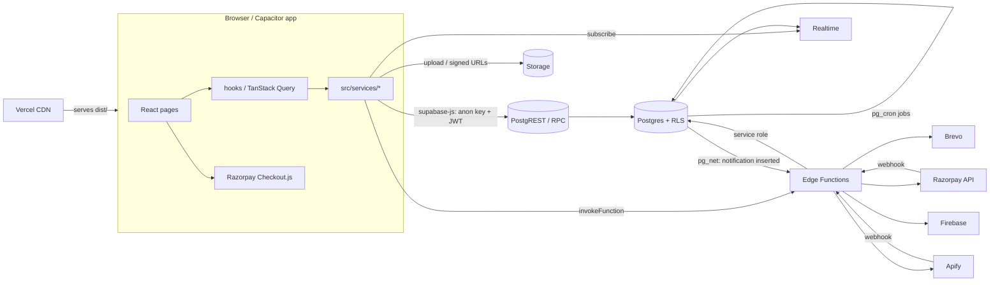

# Architecture

How House of Collabs is put together: where it runs, how a request flows, who
is allowed to do what, and which outside services it depends on. For the file
layout see [codebase-map.md](codebase-map.md). For the tables see
[database.md](database.md).

---

## 1. Principles

1. **Supabase is the whole backend.** There is no Node or Express server and
   no second database. The browser talks to Supabase with the public anon key
   plus the user's JWT.
2. **The database is the security boundary.** Row Level Security is on for all
   50 tables in `public`. Route guards in React are a convenience for users,
   not protection. Removing one in devtools reveals nothing, because Postgres
   refuses the query.
3. **Workflow and money live in SQL.** Order status changes, prices, fees,
   earnings and payouts happen inside `security definer` functions that check
   the caller. Clients have no `UPDATE` privilege on `orders`.
4. **Secrets live only in Edge Functions.** Razorpay, Brevo, Apify and Firebase
   keys are Supabase secrets. The Razorpay *key id* is sent to the browser
   with each checkout, so keys can rotate without a rebuild.
5. **Everything is reproducible from the repo**: the schema from
   `supabase/migrations`, the functions from `supabase/functions`, and the site
   from `src`. (In practice migrations are applied by hand. See
   [deployment.md](deployment.md#database-migrations).)

---

## 2. Hosting and infrastructure

| Layer | Provider | What runs there | Configured in |
| --- | --- | --- | --- |
| Website hosting / CDN | **Vercel** | Static build in `dist/` (SPA + prerendered `<head>` per public route) | `vercel.json`, Vercel project env (`VITE_SUPABASE_URL`, `VITE_SUPABASE_ANON_KEY`) |
| Source control | **GitHub** `aquilastdio-hue/Houseofcollabs` | Branch `main` only; every push deploys | n/a |
| Database | **Supabase Postgres 17** (project `sxndiarrdfqiepnnczmy`) | Tables, RLS, ~127 public + ~110 private functions, triggers | `supabase/migrations/*.sql` |
| API | Supabase **PostgREST** | `/rest/v1` tables and `/rpc/*` | exposed schemas `public`, `graphql_public`; `max_rows = 1000` |
| Auth | Supabase **Auth (GoTrue)** | Email + password, Google OAuth, invites, recovery, bans | `supabase/config.toml` `[auth]` + dashboard; invite template `supabase/templates/invite.html` |
| Files | Supabase **Storage** | 9 buckets, 15.8 GB (see [database.md](database.md#7-storage-buckets)) | migrations (`…0013_storage.sql` and later) |
| Server code | Supabase **Edge Functions** (Deno 2) | 15 deployed functions | `supabase/functions/*`, `[functions.*]` in `config.toml` |
| Scheduled jobs | **pg_cron** inside Postgres | 7 jobs: expiry, auto-cancel, auto-approve, earnings release, email queue, email campaigns, weekly Instagram | migrations (`…0014_realtime_cron_webhooks.sql` and later) |
| DB → function calls | **pg_net** + **Vault** (`project_url`, `notification_webhook_secret`) | Email dispatch, Instagram refresh kick-off | Vault in the dashboard |
| Live updates | Supabase **Realtime** (`postgres_changes`) | `orders`, `order_status_history`, `notifications` | publication `supabase_realtime` |
| Payments | **Razorpay** (live keys, plus test keys for test accounts) | Orders API, Checkout, captures, refunds, webhook | Razorpay dashboard + secrets |
| Email | **Brevo** API (`EMAIL_PROVIDER=brevo`) | Transactional email + email campaigns | secrets `BREVO_API_KEY`, `EMAIL_FROM`, `EMAIL_REPLY_TO` |
| Auth email | Supabase Auth's mailer | Invites, password resets | Supabase → Authentication → SMTP |
| Instagram data | **Apify** `apify~instagram-profile-scraper` | Weekly follower/post stats | secret `APIFY_TOKEN` |
| Phone OTP | **Firebase Auth** (web SDK) | Optional phone verification on sign-up (`require_phone_verification`, now off) | `VITE_FIREBASE_*`, secret `FIREBASE_PROJECT_ID` |
| Push (WIP) | **Firebase Cloud Messaging** | App push notifications | secret `FIREBASE_SERVICE_ACCOUNT` (not set yet) |
| Mobile apps (WIP) | **Capacitor 8** | Same web build in iOS/Android shells | `capacitor.config.ts`, `ios/`, `android/` |
| WhatsApp | none: `wa.me` click-to-chat links | Admin opens each chat by hand | `src/lib/whatsapp.ts` |



---

## 3. How a request flows

### 3.1 Reading data (most screens)

```
Page component
  └─ useQuery({ queryKey: qk.…, queryFn: service.fn })        src/lib/query-keys.ts
       └─ service.fn() → supabase.from('table').select(…)      src/services/*.service.ts
            or supabase.rpc('fn', args)
              └─ PostgREST runs as role anon / authenticated with the JWT claims
                   └─ RLS policies + column grants decide what comes back
```

Errors become `AppError` (`src/lib/errors.ts`), which maps Postgres codes and
the hint codes our functions raise (`P0001` + `hint = 'SOME_CODE'`) to friendly
messages. Failed mutations show a toast automatically
(`src/lib/query-client.ts`). Queries retry twice except on auth, permission,
not-found and validation errors.

### 3.2 Changing data

- **Simple owner edits** (a creator editing their own bio, a brand its
  profile): `update` on the table. RLS restricts it to the caller's own row,
  and column-level grants restrict which columns can change.
- **Workflow and money** (orders, briefs, campaigns, payouts, admin actions):
  `supabase.rpc('…')`. The function checks who is calling, validates, writes,
  and records an audit log and notifications.
- **Anything needing a secret or the Auth admin API**: an Edge Function through
  `invokeFunction()` (`src/lib/supabase/functions.ts`). It sends the user's JWT,
  and the function re-checks the user (`requireUser`, `requireAdmin`) before
  using the service-role client.

### 3.3 Things that happen without a user

| Trigger | Path |
| --- | --- |
| Payment captured | Razorpay → `razorpay-webhook` (HMAC check, dedupe in `webhook_events`) → `confirm_order_payment()` |
| Any notification row inserted | trigger → `email_deliveries` row → `pg_net` POST to `send-notification` → Brevo. Retries: cron `drain_email_queue()` every 5 min |
| Email campaigns due | cron `run_email_campaigns()` every 5 min → queues deliveries → same pipeline |
| Order housekeeping | cron: `expire_pending_payments` (every 15 min), `auto_cancel_unaccepted_orders` (hourly at :05), `auto_approve_stale_deliveries` (hourly at :10), `release_matured_earnings` (hourly at :20) |
| Instagram stats | cron Sunday 03:00 UTC → `request_instagram_stats_refresh()` → `pg_net` → `instagram-stats` → Apify run → Apify webhook → chunked ingest |

### 3.4 Live updates

`src/hooks/use-notifications.ts` subscribes to the signed-in user's
`notifications` inserts and updates, and also pings `touch_last_seen()` every
2 minutes. `src/hooks/use-orders.ts` subscribes to one order's row and its
`order_status_history`. Realtime applies RLS to each event.

---

## 4. Frontend architecture

- **SPA on Vite 7 + React 19**, routes in `src/routes/router.tsx`
  (`createBrowserRouter`, every page lazy-loaded through `page()`). Layouts:
  `PublicLayout`, `AuthLayout`, `BrandLayout`, `CreatorLayout` and
  `AdminLayout`, the last three lazy-loaded.
- **Guards** (`src/routes/guards.tsx`): `RequireAuth`, `RequireRole`
  (active + onboarded + right role; otherwise redirects to `/onboarding`, the
  suspended screen, or the user's own home) and `GuestOnly`.
- **Auth state** (`src/contexts/auth-context.tsx`): session, `profile`,
  `brand` or `creator` record, `refresh()`, `signOut()`. The rule for where a
  sign-in lands lives in `src/lib/auth-destination.ts`.
- **Compare tray** (`src/contexts/compare-context.tsx`): creators a brand is
  comparing side by side.
- **Bundle**: manual chunks for react, supabase, query, forms and radix
  (`vite.config.ts`). Recharts deliberately stays inside the dashboard chunks.
- **SEO**: `<Seo>` sets title/meta per page. `scripts/prerender-meta.mjs`
  writes a static `<head>` for public routes and every creator storefront,
  so link previews work for crawlers that don't run JavaScript. The
  `sitemap.xml` is generated at build time; `sitemap-creators.xml` is
  proxied to the `sitemap` Edge Function.
- **Media**: images are re-encoded in the browser (`src/utils/media.ts`), and
  videos are compressed in the browser with `mediabunny`
  (`src/lib/video-compression.ts`) before upload.
- **Native apps**: `src/lib/native.ts` (`isNativeApp`) switches a few
  behaviours: the app opens on `/login`, there's no zoom, and links point to
  the real site.

---

## 5. Identity, roles and accounts

| Concept | Where |
| --- | --- |
| Login identity | `auth.users` (Supabase Auth): email + password, or Google |
| Profile | `public.profiles` (same id): `role` (`brand` / `creator` / `admin`), `status` (`active` / `suspended` / `deleted`), `onboarding_completed`, `is_test`, email preferences, `last_seen_at` |
| Admin rights | **only** an active row in `public.admin_users` (`private.is_admin()`, `requireAdmin()`) |
| Staff (non-login) | `public.employees`: referral codes that creators enter at sign-up |

**How accounts get created** (public self sign-up through `auth.signUp` is not
used):

1. **Creator**: fills the anonymous application (`/get-started?role=creator`) →
   an admin approves it → the `approve-application` function creates the auth
   user by invite email, `provision_application_account()` builds the profile
   and storefront, and the uploads are copied to public buckets → the creator
   sets a password at `/set-password`.
2. **Brand**: self-serve at `/onboarding?role=brand` → the
   `create-brand-account` function creates the user (invite email), profile
   and brand straight away. A second, older path (`/get-started?role=brand`)
   files an application for admin review instead. See
   [scaling-review.md](scaling-review.md#5-product-and-operations).
3. **Admin CSV import**: `admin-import-accounts` creates accounts in batches of
   10, optionally emailing invites.
4. **Google sign-in**: allowed for an email that already has an approved
   application or account (migration `…0033_google_signin_for_approved.sql`).

**One email is one kind of account.** A creator email can't become a brand,
and the reverse (migration `…0024_one_account_kind_per_email.sql`). Phone and
Instagram handle are unique across creators, and WhatsApp numbers too.

**Suspend / delete**: `admin-account-action` updates `profiles.status` *and*
bans the auth user, so a suspended person can't sign in at all. Permanent
delete erases everything, but Postgres refuses (ON DELETE RESTRICT) when the
person has orders, earnings or payouts. A test account's history is removed
first by `admin_delete_test_history()`.

---

## 6. Security model

| Threat | Defence |
| --- | --- |
| Reading someone else's data | RLS on every table. Helpers in `private` (`my_brand_id()`, `my_creator_id()`, `is_order_participant()`, `can_view_brief()`…) are evaluated once per statement as `(select private.fn())` |
| Escalating your role | Role is set server-side. There is no client `UPDATE` grant on `profiles.role` or `status`. Admin comes only from `admin_users`, and the last admin can't be removed |
| Tampered prices | `create_order()` computes totals from DB rows. `create-payment` charges the DB amount. Check constraints tie `total_amount` and `creator_earning_amount` together |
| Faked payment success | `verify-payment` checks the HMAC signature in constant time, re-fetches the payment from Razorpay, compares order, amount and currency, then calls the service-role-only `confirm_order_payment()` |
| Webhook spoofing / replay | HMAC over the raw body (`RAZORPAY_WEBHOOK_SECRET`); `webhook_events` dedupes by event id |
| Illegal order transitions | `orders` has no client UPDATE; a `BEFORE UPDATE` trigger checks `order_status_transitions` for the acting role |
| Leaking sensitive columns | Column grants (e.g. full bank account numbers are write-only; admins reveal them through the audited `admin_reveal_payout_method`) |
| Search-path hijack | Every `security definer` function sets `search_path = ''` |
| Calling internal functions | `revoke execute … from public, anon`; service-only functions check `private.require_service_role()` |
| Private files | Private buckets plus `storage.objects` policies; served only by 1-hour signed URLs |
| Suspended users | `private.is_active_user()` in write policies; auth ban; `requireUser()` refuses inactive profiles |
| Cross-origin calls to functions | CORS allow-list from `ALLOWED_ORIGINS` (localhost is always allowed; see `_shared/http.ts`). This isn't the security boundary: every function checks a JWT, a signature or a secret |
| Accountability | `audit_logs` is append-only and admin-readable (3,910 rows); `private.audit()` is called from most write paths |

Known gaps (anonymous uploads, the unauthenticated brand sign-up, no CSP
header) are listed in [scaling-review.md](scaling-review.md#4-security).

---

## 7. Money model

Two billing versions exist side by side; each order records which one it
was priced with (`orders.billing_version`).

```
Billing v1 (switch off, the default until a CA signs off):
  Brand pays:      price (service + add-ons) + brand fee      (brand_fee_percentage, now 15%)
  Creator earns:   price − commission                          (platform_fee_percentage, now 15%)
  Platform keeps:  brand fee + commission

Billing v2 (switch on, or any test account; migration 0038, docs/billing.md):
  Brand pays:      price + creator GST (if registered) + brand fee + GST on brand fee
  Creator gets:    price + creator GST − TDS (194-O) − GST TCS (s.52)
  Creator owes:    commission + GST, on a separate invoice, paid from /creator/billing
  Platform keeps:  brand fee + commission (GST, TDS, TCS are liabilities in the ledger)
```

Each order snapshots the percentages it was priced at. On `completed` a
`creator_earnings` row is created: `pending` for `earning_hold_days` (7), then
`available`. The creator requests a payout (minimum ₹500, one open request at
a time). An admin pays it by bank or UPI and records the reference
(RazorpayX automation exists but isn't configured). A refund goes through
`admin-order-action` → Razorpay Refunds API → `record_refund()`.

Test accounts (`profiles.is_test` on either the brand or the creator) are
priced the same but charged with `RAZORPAY_TEST_KEY_*`
(`_shared/razorpay.ts: paymentModeForOrder`).

---

## 8. Decisions worth knowing

| Decision | Why | Where |
| --- | --- | --- |
| No custom backend | One less system to run; RLS + RPCs cover authorisation | throughout |
| Order state machine as data (`order_status_transitions`) enforced by trigger | Illegal moves are impossible even from SQL | `…0006_order_workflow.sql` |
| Every email starts as a `notifications` row | One pipeline, durable log (`email_deliveries`), retries, preferences checked in SQL | `…0020_email_delivery_and_preferences.sql` |
| Sign-up is an anonymous application, not `auth.signUp` | An admin vets every creator before they get an account | `…0030_applications.sql` and later |
| Direct messaging removed | Out of scope; briefs and orders carry the conversation | `…0051_remove_direct_messaging.sql` |
| Disputes removed | Handled by support plus admin refunds | `…0058_remove_disputes.sql` |
| Instagram via Apify scraping, weekly | No creator OAuth needed; good enough for follower counts | `instagram-stats` |
| Prefer the pasted Instagram link over the typed handle | 31 creators typed the wrong handle | `…0035_instagram_handle_from_link.sql` |
| Test accounts instead of deleting history | Keeps finance numbers true without breaking FK rules | `…0036`, `…0037` |
| Prerendered `<head>` per route | Social crawlers don't run JS | `scripts/prerender-meta.mjs` |
| Admin lists load every row (`fetchAllPages`) | Simple filtering/sorting in the browser at today's size | `src/lib/fetch-all.ts` (see the scaling review) |
