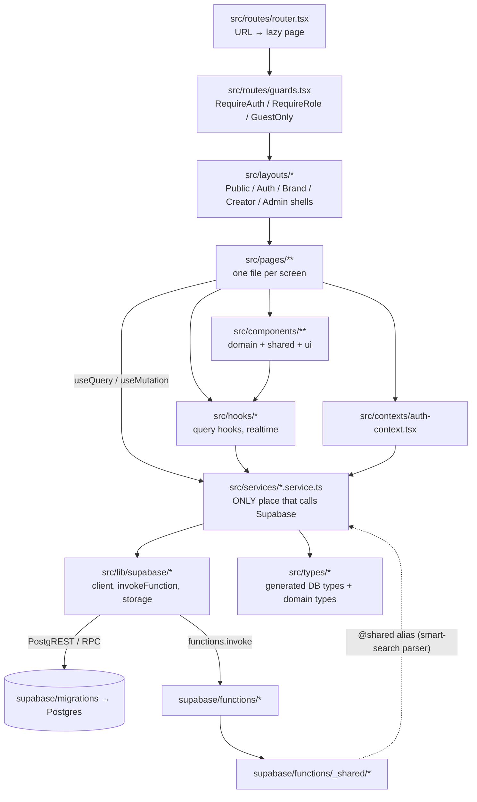

# Codebase map

Every folder, the important files in it, and how they call each other. Use it
to find where a change goes. For *why* things are built this way, see
[architecture.md](architecture.md).

Sizes as of 3 Nov 2026: about 61,000 lines of TypeScript in `src/` (395
files), about 4,200 lines of Edge Function code, 113 SQL migrations, and 212
unit tests.

---

## 1. The layers and how they connect



**The one rule that keeps this tidy:** pages and components never import
`supabase` directly. They call a service. Services return typed data or throw
`AppError`.

**Path aliases**: `@/…` → `src/…` and `@shared/…` →
`supabase/functions/_shared/…` (in `vite.config.ts`, `vitest.config.ts` and
`tsconfig.app.json`). The browser imports exactly one shared file,
`smart-search-parser.ts`, as an offline fallback.

---

## 2. Top level

```
hoc/
├── AGENTS.md               ← START HERE (agents + new developers)
├── CLAUDE.md               ← imports AGENTS.md for Claude Code
├── README.md               ← short human intro, points to AGENTS.md
├── docs/                   ← all documentation (this folder)
├── src/                    ← the React app (website + app shell)
├── supabase/               ← backend: migrations, Edge Functions, config, SQL tests
├── public/                 ← static files copied as-is into dist/
├── scripts/                ← build, sitemap, prerender, SQL test runner, app assets
├── index.html              ← SPA shell: meta tags, favicons, OG image, #root
├── vercel.json             ← build command, SPA rewrite, sitemap proxy, headers
├── vite.config.ts          ← aliases, manual chunks, dev port 5173
├── vitest.config.ts        ← test include globs (src + supabase/functions/_shared)
├── tsconfig*.json          ← strict TS; app config also type-checks the shared parser
├── package.json            ← scripts (dev, build:site, test, build:app…)
├── .env.example            ← names of public env vars + Edge Function secrets
├── .env.local              ← (git-ignored) local values; points at PRODUCTION Supabase
├── .claude/launch.json     ← dev server configs for the browser preview (dev / dev-admin / dev-guest)
├── capacitor.config.ts     ← (app WIP) iOS/Android wrapper config
├── android/  ios/  assets/ ← (app WIP) native projects and icon/splash sources
└── dist/                   ← (git-ignored) build output
```

---

## 3. `src/`: the app

### 3.1 Entry and wiring

| File | Role |
| --- | --- |
| `src/main.tsx` | Mounts React; in the native apps, locks zoom and adds the `native-app` class |
| `src/App.tsx` | Providers: QueryClient → Auth → Compare → Tooltip → Router + Toaster. Shows `SetupRequired` if env vars are missing. (App WIP: `startPush`, `startNativeAuth`) |
| `src/routes/router.tsx` | Every URL → lazy page (full table in §6) |
| `src/routes/guards.tsx` | `RequireAuth`, `RequireRole` (active, onboarded, right role; else redirect or the suspended screen), `GuestOnly` |
| `src/routes/route-error.tsx` | Error boundary page for route crashes |
| `src/contexts/auth-context.tsx` | `useAuth()`: session, user, profile, role, brand / creator record, `refresh()`, `signOut()`, `recoveryMode` |
| `src/contexts/compare-context.tsx` | Creators picked for side-by-side compare (brand) |
| `src/config/site.ts` | Product name, support email, address, header/footer nav. Rename the product here |
| `src/styles/index.css` | Tailwind 4 `@theme` design tokens (colours, fonts, radii, shadows, motion) and base styles |
| `src/vite-env.d.ts` | Types for `import.meta.env` |

### 3.2 `src/lib/`: framework-free helpers

| File | Role |
| --- | --- |
| `supabase/client.ts` | The single typed Supabase client (PKCE, persisted session, storage key `house-of-collabs-auth`) |
| `supabase/functions.ts` | `invokeFunction(name, body)`: calls an Edge Function and turns `{error, code}` into `AppError` |
| `supabase/storage.ts` | Upload, public URL, signed URLs, remove, path helpers (`ownerPath`, `scopedPath`) |
| `query-client.ts` | TanStack Query defaults; global error/success toasts for mutations (`meta.silent`, `meta.successMessage`) |
| `query-keys.ts` | `qk`: every query key. Invalidate by prefix |
| `errors.ts` | `AppError`, `toAppError()` (maps Postgres/Auth/Storage/Function errors), `unwrap()` |
| `auth-destination.ts` | Where a sign-in lands (`destinationAfterLogin`, `homeFor`, `isSafePath`) |
| `auth-link.ts` | Turns an emailed link (invite / recovery) into a session *for the account in the link* |
| `order-state.ts` | Label, tone and hint for every order status (display only; the DB decides) |
| `constants.ts` | Option lists (content types, platforms, languages, states, cities, sort options, price/age bounds, industries, report reasons) and `PAGE_SIZE` |
| `format.ts` | `formatINR`, `formatCompact`, `formatDate`, `formatRelative` |
| `utils.ts` | `cn()`, `uuid()`, `slugify`, `initials`, `truncate`, file-name helpers |
| `fetch-all.ts` | `fetchAllPages()`: loads every page of an admin list in parallel |
| `feature-requirements.ts` | Progressive profile collection: what a creator must fill in before using a feature |
| `account-import.ts` | Admin CSV import: parse and validate rows → payload for `admin-import-accounts` |
| `csv.ts` | RFC 4180 CSV read/write (Excel / Google Sheets compatible) |
| `india-time.ts` | IST helpers for email-campaign scheduling |
| `whatsapp.ts` | `wa.me` click-to-chat links |
| `phone-otp.ts`, `firebase.ts` | Firebase phone OTP, lazy-loaded only when needed |
| `video-compression.ts`, `video.ts` | In-browser video compression (mediabunny); player props for public videos |
| `portfolio-order.ts` | Portfolio order everywhere it's shown (cover first, hidden last) |
| `structured-data.ts` | schema.org JSON-LD for public pages |
| `gst.ts` | GST state codes, PAN/GSTIN validation (with check digit), financial year, amount in words |
| `invoice-pdf.ts` | Draws any billing document as an A4 PDF with `pdf-lib`. Import it lazily |
| `scroll-to-error.ts` | Scroll to and focus the first invalid form field |
| `payments/razorpay.ts` | Loads Checkout.js and opens Razorpay Checkout |
| `validation/files.ts` | Per-bucket file size / type rules, checked before upload |
| `native.ts` | `isNativeApp`, `publicOrigin()` (website vs app) |
| `native-auth.ts`, `push.ts` | (app WIP) Google/Apple sign-in through the browser sheet; FCM push registration |
| `*.test.ts` | Vitest unit tests next to the code they test |

### 3.3 `src/services/`: the data layer (only place that calls Supabase)

| Service | Tables it reads/writes | RPCs | Edge Functions |
| --- | --- | --- | --- |
| `auth.service.ts` | n/a | `complete_onboarding`, `record_auth_event` | `delete-my-account` (app WIP) |
| `profile.service.ts` | `profiles` | `touch_last_seen` | n/a |
| `applications.service.ts` | `applications` | `check_application_duplicates`, `admin_application_stats`, `admin_review_application` | `approve-application`, `verify-phone` |
| `creators.service.ts` | `creators`, `creator_social_accounts`, `creator_verifications` | `search_creators`, `get_creator_reviews`, `record_profile_view`, `get_creator_completion`, `get_creator_requirements`, `publish_creator_profile`, `set_creator_categories`, `set_creator_languages`, `request_creator_verification`, `respond_to_review` | n/a |
| `creator-services.service.ts` | `creator_services`, `service_addons` | n/a | n/a |
| `portfolio.service.ts` | `portfolio_items` (+ storage `creator-portfolio`) | n/a | n/a |
| `brands.service.ts` | `brands` (+ storage `brand-assets`) | n/a | n/a |
| `catalog.service.ts` | `categories`, `creator_types`, `platform_settings` | `get_public_stats` | n/a |
| `search.service.ts` | n/a | n/a | `smart-search` |
| `wishlists.service.ts` | `wishlists`, `wishlist_items` | n/a | n/a |
| `briefs.service.ts` | `briefs`, `brief_attachments` | `send_brief`, `respond_to_brief` | n/a |
| `campaigns.service.ts` | `creators` | `save_campaign`, `submit_campaign`, `close_campaign`, `delete_campaign`, `brand_campaigns`, `creator_campaigns`, `campaign_detail`, `campaign_applicants`, `apply_to_campaign`, `withdraw_campaign_application`, `decide_campaign_application`, `admin_list_campaigns`, `admin_review_campaign` | n/a |
| `orders.service.ts` | `orders`, `creator_services` | `calculate_order_total`, `create_order`, `cancel_order`, `accept_order`, `decline_order`, `submit_shipping_address`, `mark_order_shipped`, `mark_product_received`, `start_order_work`, `submit_deliverables`, `request_revision`, `approve_order`, `submit_review` | n/a |
| `payments.service.ts` | `payments` | n/a | `create-payment`, `verify-payment` |
| `earnings.service.ts` | `creator_earnings`, `payout_methods`, `payout_requests` | `get_earnings_summary`, `save_payout_method` | `request-payout` |
| `notifications.service.ts` | `notifications` | `mark_notification_read`, `mark_all_notifications_read`, `get_unread_counts` | n/a |
| `analytics.service.ts` | n/a | `get_creator_dashboard_stats`, `get_brand_dashboard_stats`, `record_search_event` | n/a |
| `support.service.ts` | `contact_messages` | `create_report` | n/a |
| `instagram-stats.service.ts` | `creator_instagram_stats` | n/a | `instagram-stats` |
| `email-campaigns.service.ts` | n/a | `admin_email_campaigns`, `admin_email_campaign_reach`, `admin_save_email_campaign`, `admin_email_campaign_action`, `admin_test_email_campaign` | n/a |
| `account-csv.service.ts` | `brands`, `creator_social_accounts` | n/a | `admin-import-accounts` |
| `admin.service.ts` (924 lines) | most tables, read-only for admin screens | every `admin_*` RPC (dashboard, people, creators, brands, orders, payments, payouts, reports, reviews, portfolio moderation, rankings, employees, categories, settings, audit, emails, test accounts) | `admin-order-action`, `process-payout`, `send-notification` (test/preview/retry), `admin-account-action` |
| `billing.service.ts` | `invoices`, `tax_rates`, `tax_deposits`, `billing_entity` | `get_my_billing_summary`, `save_my_tax_profile`, `admin_billing_summary`, `admin_invoice_register`, `admin_withholding_register`, `admin_save_billing_entity`, `admin_save_tax_rate`, `admin_delete_tax_rate`, `admin_record_tax_deposit`, `admin_record_invoice_payment` | `invoice-payment` |
| `push.service.ts` | n/a | `admin_push_reach`, `admin_push_messages` | `admin-send-push` (app WIP) |

### 3.4 `src/hooks/`

| Hook file | Role |
| --- | --- |
| `use-creators.ts` | Marketplace search from URL params (records searches), creator by slug or id, compare |
| `use-orders.ts` | Order queries, a realtime subscription to one order, workflow mutation wrapper |
| `use-notifications.ts` | Realtime notification stream, unread counts, `touch_last_seen` every 2 min. Mounted once per app shell |
| `use-wishlists.ts` | Wishlist queries and optimistic toggles |
| `use-catalog.ts` | Categories, creator types, public settings, public stats |
| `use-signed-url.ts` | Signed URLs for private files, cached 50 min |
| `use-hover-play.ts` | Play video on hover |
| `use-utils.ts` | `useDebounce`, `useMediaQuery` / `useIsDesktop`, `useDocumentVisible`, `useScrollTop` |

### 3.5 `src/components/`

| Folder | What's inside |
| --- | --- |
| `ui/` (28) | Primitives on Radix + cva: Button, Input, Select, Combobox, Dialog, Drawer, Tabs, DropdownMenu, Popover, Tooltip, Checkbox, Switch, RadioGroup, Slider, DatePicker, Badge, Avatar, Card, Skeleton, Spinner, Toaster… No data access |
| `shared/` (20) | Cross-feature building blocks: `states.tsx` (Empty/Error/AsyncBoundary), `confirm-dialog`, `data-table`, `file-uploader`, `image-uploader`, `audio-recorder`, `seo`, `logo`, `pagination`, `star-rating`, `review-card`, `chart`, `stats-card`, `stepper`, `photo-removed-notice` |
| `layout/` | `navbar`, `footer`, `app-shell` (sidebar + top bar for brand/creator/admin), `account-menu`, `setup-required` |
| `marketing/` (26) | Landing-page sections (hero, benefits, how-it-works, FAQs, live creator grid, live stats, journeys, contact form) |
| `marketplace/` (22) | `marketplace-view` (search page), `filter-panel` / `filter-drawer` / `filter-utils` / `active-filters`, `creator-card`, `creator-profile-*` (storefront), `creator-instagram-section`, `compare-table`, `save-button` + `wishlist-parts`, `smart-search-bar`, `send-brief-dialog`, `report-dialog` |
| `creator-studio/` (24) | Creator's own editing: `basic-info-form`, `creator-info-form`, `services-editor`, `addons-editor`, `portfolio-manager`, `social-accounts-editor`, `intro-video-form`, `payout-method-form`, `verification-*`, `completion-card`, `next-steps`, `feature-gate` (progressive requirements), `storefront-preview`, `schemas.ts` (zod) |
| `creator/` | Public bits of a creator: `portfolio-grid`, `service-card`, `whatsapp-community` |
| `brand/` | Brand dashboard panels, settings nav, smart-search hero, validators |
| `briefs/` | Brief form schema, attachments, cards, status, timeline, response panel, send dialog |
| `campaigns/` | Campaign UI, applicants list, creator invite picker |
| `billing/` | `invoice-table` (documents list, status badges, PDF download), `tax-profile-form` (creator tax details / brand billing details) |
| `orders/` | `order-actions` (who can do what next), `order-dialogs`, `order-timeline`, `deliverables-list`, `brief-panel`, `order-card`, `order-status-badge` |
| `notifications/` | `notification-bell`, `notification-list` |
| `applications/` | Sign-up wizards: `creator-wizard` (+ `-parts`), `brand-wizard`, `application-form` (chooses one), `phone-verify`, `selfie-capture` |
| `auth/` | `auth-parts.tsx`: shared auth UI (expired-link resend, reset-sent screens; app WIP: social sign-in buttons) |
| `admin/` (42) | Admin building blocks: tables (`creator-table`, `brand-table`, `order-table`), detail sections (`creator-profile`, `brand-profile`, `order-sections`, `application-detail`, `detail.tsx`), actions (`account-actions`, `creator-actions`, `order-actions`, `payout-dialog`), moderation (`portfolio-moderation`, `profile-photo`), `account-csv-menu`, `creator-instagram`, `creator-balances`, `email-campaign-ui`, `employee-dialog`, `filter-bar`, `use-url-state` (filters in the URL), `use-admin-mutation`, dashboard charts and stats |

### 3.6 `src/pages/`: one file per screen

See §6 for the route table. Folders: `public/` (+ `legal/` policy bodies),
`auth/` (+ `onboarding/`), `brand/` (+ `settings/`), `creator/`
(+ `settings/`), `admin/` (+ `forms/` previews of the sign-up forms), and
`shared/` (`OrderDetail`, `BriefDetail`, `Notifications` and
`SecuritySettings`, used by both brand and creator with a `perspective` prop).

### 3.7 Other `src/` folders

| Folder | Role |
| --- | --- |
| `layouts/` | `PublicLayout` (navbar + footer), `AuthLayout`, `BrandLayout`, `CreatorLayout`, `AdminLayout` (sidebar menus) |
| `schemas/` | Zod schemas: `auth.ts`, `creator-application.ts` (5-page creator sign-up), `brand-application.ts` (3-page brand sign-up), with tests |
| `types/` | `database.types.ts` (**generated, UTF-16 LE**; see AGENTS.md rule 13), `index.ts` (domain types built on it) |
| `utils/media.ts` | Image optimisation and video thumbnails before upload |

---

## 4. `supabase/`: the backend

```
supabase/
├── config.toml            ← local stack + auth settings + [functions.*] verify_jwt flags
├── templates/invite.html  ← "Your application is approved" invite email (Supabase Auth)
├── migrations/            ← 113 SQL files, applied in filename order (see database.md)
├── tests/                 ← SQL integration tests (stale; see AGENTS.md §4)
│   ├── 00_helpers.sql.inc
│   ├── 01_marketplace_flow.test.sql
│   └── 02_shipping_disputes_refunds.test.sql
└── functions/
    ├── _shared/           ← code shared by functions (and partly by the browser)
    └── <name>/            ← one folder per function: index.ts (Deno.serve) + handler.ts (logic)
```

### 4.1 `supabase/functions/_shared/`

| File | Role | Used by |
| --- | --- | --- |
| `http.ts` | `handler()` wrapper (CORS, JSON errors, never leaks internals), `HttpError`, `json`, `readJson`, `requireString`, `requireUuid`, `must` (DB error → HTTP) | every function |
| `supabase.ts` | `adminClient()` (service role), `userClient(req)`, `anonClient()`, `requireUser()`, `requireAdmin()`, `audit()` | every function |
| `razorpay.ts` | Razorpay REST client per mode (`razorpayFor('live'\|'test')`), `paymentModeForOrder()`, signature checks (`verifyPaymentSignature`, `verifyWebhookSignature`), `safeEqual`, RazorpayX payouts | create-payment, verify-payment, razorpay-webhook, admin-order-action, process-payout |
| `email.ts` | Email providers (`console`, `resend`, `brevo`), chosen by `EMAIL_PROVIDER`; HTML/text renderer | send-notification |
| `email-templates.ts` | Subject, preheader and button label per notification type | send-notification |
| `apify-instagram.ts` | Normalise handles, summarise an Apify profile into a stats row, `clip()` (emoji-safe truncation) | instagram-stats |
| `firebase.ts` | Verifies Firebase ID tokens (phone OTP) | verify-phone |
| `smart-search-parser.ts` | Rule-based natural-language → filters parser | smart-search **and** the browser (`@shared`) |
| `fcm.ts`, `account-removal.ts` | (app WIP) FCM sender; shared erase/close account logic | admin-send-push, delete-my-account, admin-account-action |
| `*.test.ts` | Vitest tests (run by `npm test`) | n/a |

### 4.2 Edge Functions

Fifteen are deployed; two more are app WIP. Full reference:
[edge-functions.md](edge-functions.md).

| Function | Called by | One line |
| --- | --- | --- |
| `create-payment` | brand checkout | Creates/reuses the Razorpay order for the DB amount |
| `invoice-payment` | creator (Billing & tax) | Pays a commission invoice: create the Razorpay order, then verify (billing v2) |
| `verify-payment` | brand checkout | Verifies signature + payment, confirms the order |
| `razorpay-webhook` | Razorpay | Source of truth for captures, failures, refunds, payouts |
| `admin-order-action` | admin | Refund, cancel, force-complete, set status |
| `request-payout` | creator | Opens a payout request for the available balance |
| `process-payout` | admin | Marks payouts processing/paid/failed/rejected (or RazorpayX) |
| `auto-payouts` | cron every 15 min, admin "Run now" | Pays matured earnings automatically through RazorpayX and checks payouts in flight |
| `approve-application` | admin | Creates the account from an application + invite email |
| `create-brand-account` | anonymous | Self-serve brand sign-up (account + brand row) |
| `admin-import-accounts` | admin | CSV import, 10 rows per call |
| `admin-account-action` | admin | Suspend / reactivate (with auth ban) / delete |
| `send-notification` | DB trigger (pg_net), cron, admin | Sends queued emails through Brevo; preview/test |
| `instagram-stats` | cron, Apify webhook, admin | Weekly Instagram stats via Apify |
| `verify-phone` | anonymous applicant | Records a Firebase-verified phone number |
| `smart-search` | anyone | Natural-language search → filters |
| `sitemap` | Vercel rewrite `/sitemap-creators.xml` | XML sitemap of storefronts + categories |
| `admin-send-push`, `delete-my-account` | admin / app user | (app WIP, not deployed) |

---

## 5. `scripts/` and `public/`

| File | Role |
| --- | --- |
| `scripts/build-site.mjs` | **The production build** (`npm run build:site`, used by Vercel): resolves the site URL, regenerates the sitemap, runs `tsc -b` and `vite build`, then prerenders meta |
| `scripts/generate-sitemap.mjs` | Writes `public/sitemap.xml` (static routes) and `robots.txt` |
| `scripts/prerender-meta.mjs` | Writes `dist/<route>/index.html` with a real `<head>` for public routes and every creator storefront (reads the DB) |
| `scripts/run-db-tests.mjs` | Runs `supabase/tests/*.test.sql` against `DATABASE_URL`, each in a rolled-back transaction |
| `scripts/make-app-assets.mjs` | (app WIP) Draws icon/splash sources |
| `public/robots.txt` | Crawler rules for the website (blocks `/brand`, `/creator`, `/admin`, `/auth`…) |
| `public/sitemap.xml` | Static routes (generated) |
| `public/favicon.*`, `apple-touch-icon.png`, `house-of-collabs-logo*.webp`, `og-image.png`, `preview.png` | Icons, logos, social card |

---

## 6. Route → page → data

Guards: **P** public, **G** guest-only, **A** signed in, **B** brand,
**C** creator, **AD** admin.

| Route | Guard | Page file | Main data |
| --- | --- | --- | --- |
| `/` | P | `public/Home.tsx` (apps redirect to `/login`) | `get_public_stats`, `search_creators` |
| `/get-started` (`?role=brand\|creator`) | P | `public/GetStarted.tsx` → `components/applications/*` | insert `applications`, storage `applications` |
| `/discover`, `/categories/:slug`, `/ugc`, `/barter` | P | `public/Discover.tsx`, `CategoryPage.tsx`, `UgcPage.tsx`, `BarterPage.tsx` | `search_creators` |
| `/creators/:slug` | P | `public/CreatorStorefront.tsx` → `marketplace/creator-profile-view` | `creators` + children, reviews, Instagram stats |
| `/contact` | P | `public/Contact.tsx` | insert `contact_messages` |
| `/privacy`, `/terms`, `/cookie-policy`, `/creator-guidelines`, `/brand-guidelines`, `/refund-policy`, `/payout-policy` | P | `public/LegalPage.tsx` + `public/legal/*` | static |
| `/collabs`, `/creators` | A | redirect to `/brand`, `/creator` | n/a |
| `/login`, `/forgot-password` | G | `auth/Login.tsx`, `auth/ForgotPassword.tsx` | Supabase Auth |
| `/reset-password`, `/set-password`, `/auth/callback` | P | `auth/ResetPassword.tsx`, `SetPassword.tsx`, `AuthCallback.tsx` | `lib/auth-link.ts` |
| `/onboarding` (`?role=brand`) | P | `auth/Onboarding.tsx` → `onboarding/BrandOnboarding.tsx` / `CreatorOnboarding.tsx` | `create-brand-account` |
| `/brand` | B | `brand/Dashboard.tsx` | `get_brand_dashboard_stats` |
| `/brand/creators`, `/brand/creators/:id`, `/brand/compare` | B | `brand/Marketplace.tsx`, `CreatorProfile.tsx`, `Compare.tsx` | `search_creators`, creator by id |
| `/brand/checkout/:serviceId` | B | `brand/Checkout.tsx` | `calculate_order_total`, `create_order`, `create-payment`, `verify-payment` |
| `/brand/orders`, `/brand/orders/:id` | B | `brand/Orders.tsx`, `shared/OrderDetail.tsx` | `orders` + realtime |
| `/brand/briefs…` (list, new, `:id`, `:id/edit`) | B | `brand/Briefs.tsx`, `BriefEditor.tsx`, `shared/BriefDetail.tsx` | `briefs`, `send_brief` |
| `/brand/campaigns…` (list, new, `:id`, `:id/edit`) | B | `brand/Campaigns.tsx`, `CampaignEditor.tsx`, `CampaignDetail.tsx` | campaign RPCs |
| `/brand/wishlists`, `/brand/notifications` | B | `brand/Wishlists.tsx`, `shared/Notifications.tsx` | `wishlists`, `notifications` |
| `/brand/settings/{profile,contact,security,billing}` | B | `brand/settings/*`, `shared/SecuritySettings.tsx` | `brands`, `profiles`, `payments` |
| `/creator` | C | `creator/Dashboard.tsx` | `get_creator_dashboard_stats`, completion |
| `/creator/{profile,portfolio,services}` | C | `creator/ProfileEditor.tsx`, `Portfolio.tsx`, `Services.tsx` | `creators`, `portfolio_items`, `creator_services` |
| `/creator/orders…`, `/creator/briefs…`, `/creator/campaigns…` | C | `creator/Orders.tsx`, `Briefs.tsx`, `Campaigns.tsx`, `CampaignDetail.tsx`, shared detail pages | order, brief and campaign RPCs |
| `/creator/earnings`, `/creator/payouts` | C | `creator/Earnings.tsx`, `Payouts.tsx` | `creator_earnings`, `payout_*`, `request-payout` |
| `/creator/billing` | C | `creator/Billing.tsx` | `get_my_billing_summary`, `invoices`, `invoice-payment`, `save_my_tax_profile` |
| `/creator/notifications`, `/creator/settings/{profile,social,security}` | C | `shared/Notifications.tsx`, `creator/settings/*`, `shared/SecuritySettings.tsx` | `profiles`, `creator_social_accounts` |
| `/admin` | AD | `admin/Dashboard.tsx` | `admin_dashboard_stats`, `admin_timeseries` |
| `/admin/people`, `/admin/applications`, `/admin/rejected` | AD | `admin/People.tsx`, `Applications.tsx`, `RejectedApplications.tsx` | `admin_list_people`, `applications`, `approve-application` |
| `/admin/creators`, `/admin/creators/:id`, `/admin/creator-ranking` | AD | `admin/Creators.tsx`, `CreatorDetail.tsx`, `CreatorRanking.tsx` | `admin_list_creators`, `admin_creator_rankings`, `instagram-stats` |
| `/admin/brands`, `/admin/brands/:id` | AD | `admin/Brands.tsx`, `BrandDetail.tsx` | `admin_list_brands` |
| `/admin/billing` (`?tab=invoices\|taxes\|settings`) | AD | `admin/Billing.tsx` → `components/admin/billing-{overview,books,setup}.tsx` | `admin_billing_summary`, `invoices`, registers, `tax_deposits`, `tax_rates`, `billing_entity` |
| `/admin/orders`, `/admin/orders/:id`, `/admin/payments`, `/admin/payouts`, `/admin/finance` | AD | `admin/Orders.tsx`, `OrderDetail.tsx`, `Payments.tsx`, `Payouts.tsx`, `Finance.tsx` | `admin-order-action`, `process-payout`, `admin_revenue_summary`, `admin_creator_balances` |
| `/admin/briefs`, `/admin/campaigns`, `/admin/campaigns/:id` | AD | `admin/Briefs.tsx`, `Campaigns.tsx`, `CampaignDetail.tsx` | `briefs`, `admin_list_campaigns`, `admin_review_campaign` |
| `/admin/email-campaigns…`, `/admin/emails`, `/admin/notifications`, `/admin/whatsapp`, `/admin/push` | AD | `admin/EmailCampaigns.tsx`, `EmailCampaignEditor.tsx`, `Emails.tsx`, `Notifications.tsx`, `WhatsApp.tsx`, `PushNotifications.tsx` (WIP) | email campaign RPCs, `email_deliveries`, `admin_broadcast_notification` |
| `/admin/employees`, `/admin/employees/:id` | AD | `admin/Employees.tsx`, `EmployeeDetail.tsx` | `employees`, `admin_employee_referrals` |
| `/admin/categories`, `/admin/content`, `/admin/reports`, `/admin/forms…`, `/admin/settings`, `/admin/audit-logs` | AD | matching files in `admin/` | categories, reviews/portfolio/contact moderation, `reports`, form previews, `platform_settings`, `audit_logs` |
| `*` | P | `public/NotFound.tsx` | n/a |

---

## 7. Worked example: how files talk during a purchase

```
brand/Checkout.tsx
  ├─ orders.service.quoteOrder()      → rpc calculate_order_total   (price + brand fee, from DB)
  ├─ orders.service.createOrder()     → rpc create_order            (order row, status payment_pending)
  └─ payments.service.payForOrder()
       ├─ invokeFunction('create-payment')  → functions/create-payment/handler.ts
       │     └─ _shared/razorpay.ts  razorpayFor(mode).createOrder()   (mode = test if a test account)
       ├─ lib/payments/razorpay.ts  openCheckout()                    (Razorpay Checkout.js in the browser)
       └─ invokeFunction('verify-payment')  → functions/verify-payment/handler.ts
             ├─ verifyPaymentSignature + fetchPayment (+ capture)
             └─ rpc confirm_order_payment   (service role only)
                   └─ triggers: order_status_history, notify() → notifications → email pipeline
  (in parallel) Razorpay → functions/razorpay-webhook → same confirm_order_payment (idempotent)
shared/OrderDetail.tsx  ← hooks/use-orders.ts realtime subscription refreshes the page
```
