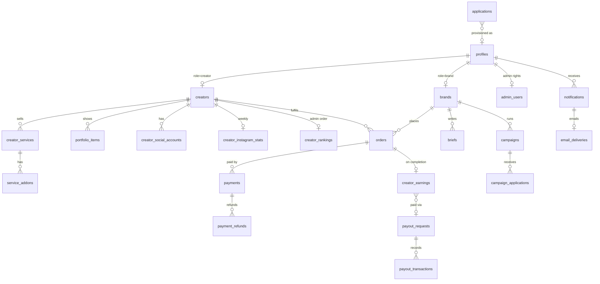
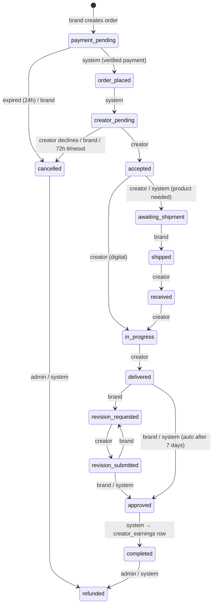

# Database

Postgres 17 on Supabase (project `sxndiarrdfqiepnnczmy`). The schema lives in
`supabase/migrations/` (113 files). This page explains what's there. When in
doubt, the **latest migration that touches an object is its current
definition**. Find it with
`grep -l "function public.<name>" supabase/migrations/* | tail -1`, or read it
live with `supabase db query --linked "select pg_get_functiondef('public.<name>'::regproc)"`.

Numbers below are from 3 Nov 2026.

---

## 1. Schemas

| Schema | What's in it | Exposed to the API? |
| --- | --- | --- |
| `public` | 50 tables (all with RLS), 127 functions (RPCs), views | yes (PostgREST) |
| `private` | 110 helper and trigger functions, table `phone_verifications` | **no** |
| `auth` | Supabase Auth users (283) | no |
| `storage` | Buckets and objects (9 buckets, about 6,000 files) | via Storage API |
| `cron` | pg_cron jobs (7) | no |
| `net` | pg_net HTTP queue (DB → Edge Functions) | no |
| `vault` | Secrets for DB-originated calls: `project_url`, `notification_webhook_secret` | no |
| `supabase_migrations` | Migration history (**out of date**: see [§8](#8-migrations)) | no |

Extensions: `pg_cron`, `pg_net`, `pg_trgm` (fuzzy name search),
`fuzzystrmatch` (levenshtein), `pgcrypto`, `uuid-ossp`, `pg_stat_statements`,
`supabase_vault`.

---

## 2. Tables by domain

Row counts are approximate.

### Accounts and people

| Table | Rows | Purpose |
| --- | --- | --- |
| `profiles` | 276 | One per auth user (same `id`). `role`, `status`, `onboarding_completed`, `is_test`, email preference switches (`email_notifications`, `email_orders`, `email_payments`, `email_campaigns`, `email_account`, `email_marketing`), `last_seen_at`, `photo_removed_at` |
| `admin_users` | 1 | **The only source of admin rights** (`profile_id`, `active`). Grant with `select private.grant_admin('email')` |
| `employees` | 0 | Staff referral codes; creators enter one at sign-up (`creators.referral_code`) |
| `applications` | 315 | Anonymous sign-up submissions. `role`, `status` (`new` / `reviewing` / `approved` / `rejected`), contact fields, `profile` (jsonb: the whole form), `image_path` / `video_path` (files in the private `applications` bucket), `admin_rating`, `discover`, `profile_id` once provisioned |
| `private.phone_verifications` | n/a | Phone numbers proven through Firebase OTP (written only by `verify-phone`) |

### Creator catalogue

| Table | Rows | Purpose |
| --- | --- | --- |
| `creators` | 273 | The storefront. Identity (`display_name`, `slug`, `headline`, `bio`, photos, `intro_video_url`), location, `gender`, `age`, `creator_type`, `status` (`draft` / `pending_review` / `published` / `rejected` / `suspended`), `deleted_at`, plus **denormalised search columns** kept by triggers: `starting_price`, `fastest_delivery_days`, `content_types`, `followers_count`, `rating`, `review_count`, `wishlist_count`, `profile_views`, `search_vector`. Barter: `barter_available`, `barter_stance`, `travel_scope`, `open_to`. 21 indexes |
| `creator_categories` | 832 | Creator ↔ `categories` |
| `categories`, `creator_types` | small | Admin-managed taxonomies |
| `creator_languages` | 109 | Languages a creator works in |
| `creator_social_accounts` | 307 | Social handles + follower counts. Instagram handle unique across creators. Admin-only reads (`…0055`) |
| `creator_services` | 1,023 | Fixed-price packages (`price`, `delivery_days`, `revisions_included`, `content_type`, `requires_shipping`, `display_order`, `active`, `archived_at`) |
| `service_addons` | 98 | Paid add-ons per service (`addon_type`: extra revision, express delivery, raw footage, usage rights…) |
| `portfolio_items` | 1,418 | Photos / videos / links in `creator-portfolio`; `sort_order` (first visible = storefront cover), `is_hidden` (admin moderation) |
| `creator_verifications` | small | ID verification requests (document in the private `verification-documents` bucket; only the last 4 digits stored) |
| `creator_rankings` | 264 | Admin ordering of the marketplace: `admin_rating`, `pinned_at`, `sort_order`, `note`. Drives `search_creators` relevance |
| `creator_instagram_stats` | 271 | Weekly Apify snapshot: followers, posts, average likes / comments / reel views, engagement, `recent_posts` (jsonb, images in the `instagram-media` bucket), `status`, `last_error` |
| `creator_profile_views` | 1,078 | One row per storefront view (analytics) |

### Brand side

| Table | Rows | Purpose |
| --- | --- | --- |
| `brands` | 2 | Brand profile: name, slug, logo, pronunciation (text + audio), website, Instagram, industry, location, contacts, `preferences` (jsonb from the sign-up form) |
| `wishlists`, `wishlist_items` | 0 | Saved creators (a default list is made per brand) |
| `briefs`, `brief_attachments` | 5 | A brand's written brief sent to one creator; `brief_status` `draft` → `sent` → `accepted` / `rejected` → `completed` |
| `campaigns` | 0 | Open call to many creators: brief, deliverables, platforms, compensation / fee, barter details, targeting (categories, followers, cities), `apply_by`; `campaign_status` `draft` → `pending_review` (admin) → `live` → `closed` / `rejected` |
| `campaign_invites` | 0 | Creators a brand invited directly |
| `campaign_applications` | 0 | A creator's pitch to a campaign; brand decides |

### Orders and money

| Table | Rows | Purpose |
| --- | --- | --- |
| `orders` | 5 | Snapshot of the service and brief, money columns (`subtotal`, `addons_total`, `brand_fee_percent/amount`, `platform_fee_percent/amount`, `total_amount`, `creator_earning_amount`, enforced by check constraints), revisions, `due_at`, lifecycle timestamps, `refund_required`. `order_number` prefixed `HOC-` |
| `order_items` | 0 | Add-ons on an order |
| `order_status_transitions` | 75 | **The state machine as data** `(from_status, to_status, actor)` (see §4) |
| `order_status_history` | 0 | Timeline (trigger-written) |
| `order_deliverables` | 37 | Delivered files (`order-deliverables` bucket) or links, per revision round |
| `order_revisions` | 0 | Revision requests and their resolution |
| `shipping_details` | 31 | For services that need a product shipped to the creator |
| `reviews` | 0 | Brand → creator review after completion; creator can respond |
| `payments` | 5 | Razorpay order/payment ids, amount, status (`created` / `authorized` / `captured` / `failed` / `refunded` / `partially_refunded`), `refunded_amount`. Signature column not selectable by clients |
| `payment_refunds` | small | One row per refund |
| `webhook_events` | small | Razorpay event ids already processed (idempotency) |
| `creator_earnings` | 0 | One per completed order: gross, fee, net, `earning_status` (`pending` → `available` → `paid`, or `held` / `refunded`), `available_at`, `payout_request_id` |
| `payout_methods` | small | UPI or bank. Full account number is write-only for clients; admins reveal it through the audited `admin_reveal_payout_method` |
| `payout_requests`, `payout_transactions` | small | Creator's request and the admin's transfer record (reference / UTR) |

### Communication

| Table | Rows | Purpose |
| --- | --- | --- |
| `notifications` | 1,174 | In-app notifications (realtime). **Every email starts here** (written only by `private.notify()`) |
| `email_deliveries` | 1,501 | Durable email log/queue: recipient, category, subject, `status` (`pending` / `processing` / `sent` / `failed` / `skipped`), `attempts`, `next_attempt_at`, `provider_message_id`, `campaign_id` |
| `email_campaigns` | 1 | Admin email campaigns: subject, body, button, audience (`recipient_ids` for hand-picked), `audience` (`creators` / `brands` / `everyone` / `specific`, up to 500 hand-picked), `schedule` (`now` / `once` / `daily` at `daily_time` IST), `status` (`draft` / `scheduled` / `active` / `paused` / `sent`), `next_run_at` |
| `contact_messages` | small | Contact form submissions (rate-limited by trigger) |
| `reports` | small | User reports on creators, brands, portfolio, reviews, orders |
| `push_devices`, `push_messages` | 0 | (app WIP, migration `…0028`, applied live but uncommitted) Phone tokens and sent pushes |

### Billing and tax (migration `…0038`, see [billing.md](billing.md))

| Table | Purpose |
| --- | --- |
| `billing_entity` | HOC's own GSTIN, PAN, TAN, state, address, SAC codes (one row, admin-only) |
| `tax_rates` | Effective-dated GST / TDS / TCS rates and the 194-O exemption limit |
| `creator_tax_profiles`, `brand_billing_profiles` | Each party's legal name, PAN, GSTIN, state, address (written only through `save_my_tax_profile`) |
| `invoices` | Every document (creator invoice, brand commission, creator commission, settlement statement, credit note), frozen at issue |
| `invoice_counters` | Gapless numbering per series and financial year |
| `invoice_payments` | Creator commission payments (Razorpay or recorded by an admin) |
| `tax_withholdings` | TDS and TCS per order; `unique (order_id, tax_type)` |
| `tax_deposits` | Challans paid to the government and the return they were filed in |
| `ledger_entries` | Double-entry ledger for billing v2 money; each posting sums to zero |

### Platform

| Table | Purpose |
| --- | --- |
| `platform_settings` | Key/value settings, edited in Admin → Settings through `admin_update_setting` (validated). Current: `platform_fee_percentage` 15, `brand_fee_percentage` 15, `earning_hold_days` 7, `minimum_payout_amount` 500, `creator_response_hours` 72, `auto_approve_days` 7, `payment_expiry_hours` 24, `max_revisions` 5, `require_creator_approval` true, `require_phone_verification` false, `cancellation_rules`, `refund_rules`, `support_email` (**still a placeholder**), `daily_creator_email` (jsonb, disabled) |
| `audit_logs` | 3,910 rows, append-only. `actor_id`, `actor_role`, `action`, `entity_type`, `entity_id`, `metadata` (jsonb; note the column is `metadata`, not `details`) |
| `search_events` | Marketplace searches (query, filters, result count) |



`orders`, `creator_earnings` and `payout_requests` reference brands and
creators with **ON DELETE RESTRICT**, so an account that has traded can't be
deleted (suspend it instead). Test accounts are the exception: their history
is removed first by `admin_delete_test_history()`.

---

## 3. Functions (RPCs)

All `security definer` with `set search_path to ''`. User-facing ones check
`auth.uid()` and the caller's role. Admin ones begin with
`private.require_admin()`. Service-only ones (called by Edge Functions) check
`private.require_service_role()` and have `execute` revoked from `anon` and
`authenticated`.

| Group | Functions |
| --- | --- |
| Marketplace (anon + authenticated) | `search_creators` (all filtering, sorting, pagination, `total_count`; latest definition in `…0036_test_accounts.sql`), `get_creator_reviews`, `record_profile_view`, `record_search_event`, `get_public_stats` |
| Sign-up | `check_application_duplicates`, `check_email_before_application`, `check_phone_before_otp`, `record_phone_verification` (service), `provision_application_account` (admin), `mark_application_invited`, `admin_import_account` (admin) |
| Creator studio | `get_creator_completion`, `get_creator_requirements`, `publish_creator_profile`, `set_creator_categories`, `set_creator_languages`, `request_creator_verification`, `respond_to_review`, `save_payout_method`, `get_creator_dashboard_stats`, `get_earnings_summary` |
| Brand | `get_brand_dashboard_stats`, `send_brief`, `respond_to_brief` (creator) |
| Campaigns | `save_campaign`, `submit_campaign`, `close_campaign`, `delete_campaign`, `brand_campaigns`, `creator_campaigns`, `campaign_detail`, `campaign_applicants`, `apply_to_campaign`, `withdraw_campaign_application`, `decide_campaign_application`, `admin_list_campaigns`, `admin_review_campaign` |
| Orders | `calculate_order_total`, `calculate_platform_fee`, `create_order`, `cancel_order`, `accept_order`, `decline_order`, `submit_shipping_address`, `mark_order_shipped`, `mark_product_received`, `start_order_work`, `submit_deliverables`, `request_revision`, `approve_order`, `submit_review`, `admin_transition_order` (service) |
| Payments (service only) | `register_payment_attempt`, `confirm_order_payment`, `mark_payment_failed`, `record_refund` |
| Earnings and payouts | `create_payout_request` (service), `complete_payout` (service), `release_matured_earnings` (cron), `calculate_creator_earnings` |
| Housekeeping (cron) | `expire_pending_payments`, `auto_cancel_unaccepted_orders` (sets `refund_required`; **the refund itself is manual**), `auto_approve_stale_deliveries`, `release_matured_earnings` |
| Notifications and email | `get_unread_counts`, `mark_notification_read`, `mark_all_notifications_read`, `claim_pending_emails`, `record_email_result`, `touch_last_seen`, `record_auth_event` |
| Instagram | `instagram_stats_targets` (who to fetch; prefers the pasted link), `instagram_stats_upsert` |
| Push (app WIP) | `register_push_device`, `unregister_push_device`, `push_audience_devices`, `admin_push_reach`, `admin_push_messages` |
| Admin | `admin_dashboard_stats`, `admin_timeseries`, `admin_people_stats`, `admin_list_people`, `admin_revenue_summary`, `admin_list_creators`, `admin_list_brands`, `admin_creator_balances`, `admin_creator_rankings`, `admin_set_creator_rating`, `admin_pin_creator`, `admin_reorder_creators`, `admin_set_creator_status`, `admin_set_creator_flags`, `admin_update_creator`, `admin_soft_delete_creator`, `admin_restore_creator`, `admin_update_brand`, `admin_set_user_status`, `admin_application_stats`, `admin_review_application`, `admin_rate_application`, `admin_set_application_discover`, `admin_moderate_portfolio_item`, `admin_delete_portfolio_item`, `admin_set_portfolio_cover`, `admin_set_profile_photo_from_post`, `admin_remove_profile_photo`, `admin_moderate_review`, `admin_update_report`, `admin_update_contact_message`, `admin_review_creator_verification`, `admin_reveal_payout_method`, `admin_broadcast_notification`, `admin_employee_referrals`, `admin_email_stats`, `admin_email_campaigns`, `admin_email_campaign_reach`, `admin_save_email_campaign`, `admin_email_campaign_action`, `admin_test_email_campaign`, `admin_update_setting`, `admin_set_test_account`, `admin_delete_test_history`, `purge_account_records` |

Errors are raised as `raise exception 'Human message' using errcode = 'P0001',
hint = 'MACHINE_CODE'`. The frontend (`toAppError`) and the Edge Functions
(`fromDbError`) both turn those into user-safe messages. Keep that pattern.

**Important `private` helpers**: `is_admin()`, `require_admin()`,
`require_service_role()`, `user_role()`, `my_brand_id()`, `my_creator_id()`,
`is_active_user()`, `is_creator_public()`, `is_order_participant()`,
`can_view_brief()`, `can_view_brand()`, `transition_order()`, `notify()`,
`notify_admins()`, `audit()`, `setting()` / `setting_numeric()` /
`setting_bool()`, `normalize_phone()`, `normalize_instagram()`,
`instagram_handle_from_link()`, `wants_email()`, `email_category()`,
`dispatch_notification_email()`, `drain_email_queue()`,
`run_email_campaigns()`, `is_test_profile()`, `is_test_creator()`,
`is_test_order()`, `slugify()`, `grant_admin()`, `revoke_admin()`.

---

## 4. Order state machine

Statuses (enum `order_status`; `disputed` is retired): `draft`,
`payment_pending`, `order_placed`, `creator_pending`, `accepted`,
`awaiting_shipment`, `shipped`, `received`, `in_progress`, `delivered`,
`revision_requested`, `revision_submitted`, `approved`, `completed`,
`cancelled`, `refunded`.



Admins can also cancel from any active status and force `delivered` /
`revision_submitted` → `approved`. Enforcement has four layers: RPC checks →
the `BEFORE UPDATE` trigger `enforce_order_transition` against
`order_status_transitions` → the `AFTER UPDATE` trigger
`after_order_status_change` (history, notifications, earnings, audit) → no
client `UPDATE` grant on `orders`.

---

## 5. Triggers (highlights)

| On | Does |
| --- | --- |
| `auth.users` insert / email change | `handle_new_user` (profile from invite metadata; role whitelisted, never `admin`), `handle_user_email_change` |
| `profiles` | one-account-kind-per-email guard, audit of sensitive changes, `updated_at` |
| `applications` | before insert: pin status/review fields, duplicate + rate checks (3 per email per hour), phone-verification check when required; after insert: notify admins |
| `creators` / `brands` | unique slug, `search_vector`, validation, audit |
| `creator_services`, `service_addons` | refresh `starting_price`, `fastest_delivery_days`, `content_types` |
| `creator_social_accounts`, `creator_instagram_stats` | refresh `followers_count` |
| `reviews`, `wishlist_items` | refresh `rating` / `review_count`, `wishlist_count` |
| `orders` | `enforce_order_transition` (before), `after_order_status_change` (after) |
| `notifications` insert | `dispatch_notification_email`: preference check → `email_deliveries` row → `pg_net` call to `send-notification` |
| `contact_messages` | rate limit |
| `platform_settings`, `categories`, `creator_types` | audit config changes |

---

## 6. Scheduled jobs (pg_cron, UTC)

| Job | Schedule | Calls |
| --- | --- | --- |
| `house-of-collabs-drain-email-queue` | every 5 min | `private.drain_email_queue()`: retries pending/failed emails with backoff |
| `house-of-collabs-email-campaigns` | every 5 min | `private.run_email_campaigns()`: queues due campaigns |
| `house-of-collabs-expire-pending-payments` | every 15 min | `public.expire_pending_payments()`: cancels unpaid orders after `payment_expiry_hours` |
| `house-of-collabs-auto-cancel-unaccepted` | hourly at :05 | `public.auto_cancel_unaccepted_orders()`: cancels after `creator_response_hours`, sets `refund_required` |
| `house-of-collabs-auto-approve-deliveries` | hourly at :10 | `public.auto_approve_stale_deliveries()`: approves after `auto_approve_days` |
| `house-of-collabs-release-earnings` | hourly at :20 | `public.release_matured_earnings()`: `pending` → `available` |
| `house-of-collabs-auto-payouts` | every 15 min | `private.request_auto_payouts()`: wakes the `auto-payouts` Edge Function when earnings have matured or a RazorpayX payout is in flight (migration `…0041`) |
| `house-of-collabs-instagram-stats` | Sun 03:00 UTC (08:30 IST) | `private.request_instagram_stats_refresh()`: starts the Apify refresh |

Check job health: `select * from cron.job_run_details order by start_time desc limit 20;`

---

## 7. Storage buckets

| Bucket | Public | Max file | Files | Size | Holds | Write | Read |
| --- | --- | --- | --- | --- | --- | --- | --- |
| `applications` | no | 20 MB | 2,575 | **9.0 GB** | Sign-up photos, videos, documents | **anyone (anon)** | admins |
| `creator-portfolio` | yes | 50 MB | 1,538 | **6.5 GB** | Portfolio photos/videos, intro videos | owner creator | public |
| `instagram-media` | yes | 5 MB | 1,822 | 214 MB | Copies of Instagram profile pics and recent posts | service role | public |
| `avatars` | yes | 5 MB | 40 | 15 MB | Profile photos | owner | public |
| `verification-documents` | no | 10 MB | 10 | 9 MB | ID documents | owner creator | owner + admins |
| `brief-attachments` | no | 25 MB | 1 | 4 MB | Brief files | owning brand | brand + creator + admins |
| `brand-assets` | yes | 10 MB | 4 | 0.4 MB | Brand logos, pronunciation audio | owner brand | public |
| `order-deliverables` | no | 50 MB | 0 | n/a | Delivered work | order parties | order parties + admins |
| `message-attachments` | no | 25 MB | 0 | n/a | Unused (messaging removed) | n/a | n/a |

Path conventions: `{auth.uid}/{uuid}.{ext}` for owner buckets and
`{brief_id|order_id}/{uuid}-{name}` for scoped ones. Private files are served
through 1-hour signed URLs (`useSignedUrls`). `approve-application` *copies*
an applicant's files into public buckets, so approved creators' media is
stored twice. About 1.7 GB in `applications` (678 files) belongs to no
application. See [scaling-review.md](scaling-review.md#2-what-breaks-first-and-when).

---

## 8. Migrations

**Naming**: `YYYYMMDD` + `0000NN` + `_snake_case_name.sql`. `NN` is a running
counter: the latest is `20261104000038` (billing, not yet applied), so the
next one is `2026MMDD000039_…`. (Older files restart the counter. Filename order is what
counts.)

**How they reach production**: the owner pastes the file into the Supabase SQL
Editor. Because of that, `supabase_migrations.schema_migrations` only records
up to `20261026000012`. The 24 files from `20261028000014` to
`20261103000037` are live but unrecorded. **Do not run `supabase db push`.**
To bring the history back in line (owner's call):

```bash
supabase migration repair --status applied 20261028000014 20261028000015 … 20261103000037 --linked
```

### Writing a migration

```sql
-- 0038 - <Title in plain words>
--
-- Why this change exists, what it fixes, what it deliberately doesn't do.

begin;

-- tables: create table if not exists …; alter table … add column if not exists …
alter table public.thing enable row level security;
create policy "…" on public.thing for select to authenticated using (…);
grant select on public.thing to authenticated;            -- explicit grants

create or replace function public.do_thing(p_id uuid)
returns void
language plpgsql
security definer
set search_path to ''                                       -- always
as $$
declare
  v_admin uuid := private.require_admin();                  -- for admin RPCs
begin
  … schema-qualify everything: public.table, private.fn() …
  if not found then
    raise exception 'Thing not found.' using errcode = 'P0002', hint = 'THING_NOT_FOUND';
  end if;
  perform private.audit('thing_done', 'thing', p_id::text, jsonb_build_object(…), v_admin, 'admin');
end;
$$;

revoke execute on function public.do_thing(uuid) from public, anon;
grant execute on function public.do_thing(uuid) to authenticated;

commit;
```

Checklist:

- [ ] Idempotent (`create or replace`, `if not exists`, `on conflict do nothing`), so re-running is safe.
- [ ] When replacing a function, start from the **live** definition
      (`pg_get_functiondef`), not an older migration. Several have been
      rewritten many times.
- [ ] Test accounts excluded from any new count or listing (`private.is_test_*`).
- [ ] Dry-run against live: `supabase db query --linked "begin; <sql> rollback;"`.
- [ ] Add the new tables and functions to `src/types/database.types.ts` (UTF-16; see AGENTS.md rule 13).
- [ ] Update this file if you add a table, cron job, bucket or important RPC.
- [ ] Hand the file to the owner to run. Don't apply it yourself.
